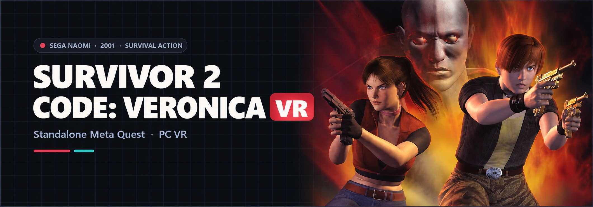

<div align="center">



# Survivor 2 - Code: Veronica VR
### SEGA NAOMI Survival Action · Standalone Meta Quest & PC VR

[](https://github.com/vr4all-standalone/survivor2-code-veronica-vr/releases/tag/v1.0.0-preview.2)
[](#installation)
[](#bring-your-own-game)

**[⬇️ Quest APK](https://github.com/vr4all-standalone/survivor2-code-veronica-vr/releases/download/v1.0.0-preview.2/survivor2-code-veronica-vr-quest.apk)** · **[🖥️ PC VR ZIP](https://github.com/vr4all-standalone/survivor2-code-veronica-vr/releases/download/v1.0.0-preview.2/survivor2-code-veronica-vr-pcvr.zip)** · **[🎮 Controls](#controls)**

[Checksums](https://github.com/vr4all-standalone/survivor2-code-veronica-vr/releases/download/v1.0.0-preview.2/SHA256SUMS.txt) · [All releases](https://github.com/vr4all-standalone/survivor2-code-veronica-vr/releases)

**[🌐 VR4ALL — Standalone VR Mod Installer](https://github.com/vr4all-standalone/vr4all-standalone-vr-mod-installer)**

</div>

---

## Overview

Standalone Quest and PC OpenXR adaptation of **Resident Evil Survivor 2 – Code: Veronica**, NAOMI World BHF2 Ver. E (`gunsur2`). **Experimental preview** for one player per app instance. The user reports successful headset gameplay on preview 1. The weapon update has separate automated and simulator checks; physical testing of this update remains open.

The port uses stereoscopic head tracking, a level first-person body camera, tracked controller aiming, native analog movement and 30° snap turns. It reuses the Confidential Mission/Lupin VR menus, setup and licensed gun/controller assets. One player per app instance is supported initially.

<a id="installation"></a>
## Downloads — v1.0.0-preview.2

| Platform | Download |
| --- | --- |
| Meta Quest (arm64) | [Quest APK](https://github.com/vr4all-standalone/survivor2-code-veronica-vr/releases/download/v1.0.0-preview.2/survivor2-code-veronica-vr-quest.apk) |
| Windows x64 / PC OpenXR | [PC VR portable ZIP](https://github.com/vr4all-standalone/survivor2-code-veronica-vr/releases/download/v1.0.0-preview.2/survivor2-code-veronica-vr-pcvr.zip) |

[Release notes and known limits](https://github.com/vr4all-standalone/survivor2-code-veronica-vr/releases/tag/v1.0.0-preview.2) · [SHA-256 checksums](https://github.com/vr4all-standalone/survivor2-code-veronica-vr/releases/download/v1.0.0-preview.2/SHA256SUMS.txt) · [Corresponding binary source](https://github.com/vr4all-standalone/survivor2-code-veronica-vr/tree/v1.0.0-preview.2)

Both downloads are built from the exact source commit identified by the release tag and the APK version suffix. `main` may include later documentation. The Quest APK uses the project's release signer and package `com.vrlightgunhub.survivor2`. No game or BIOS is included.

On Quest, sideload the APK or use the **Survivor 2 - Code: Veronica VR** card in VR4ALL. Grant file access if requested, supply your game files below, then open the app under **Unknown Sources**. For PC VR, extract the ZIP, place the files in `roms`, activate your OpenXR runtime and run **Play Survivor 2.cmd**.

## Bring your own game

Supply your complete `gunsur2.zip` and a supported `naomi.zip`, or a compatible BIOS inside the game ZIP. The World cartridge contains 15 ROMs. No CHD or PIC is needed. Japanese revisions are unsupported; renaming a clone does not convert it.

Quest setup finds the files under accessible Download folders and explains missing requirements. PC: put them in `roms` beside `flycast.exe` and run **Play Survivor 2.cmd**. Both setup paths check ROM lengths and CRC metadata. That check does not certify compressed payload integrity; native loading must still succeed. Loaded cartridge metadata and native instruction signatures guard the integration separately.

No game, BIOS, extracted game model, raw memory capture or signing key belongs in a software package.

<a id="controls"></a>
## Controls and shared menu

| Control | Action |
| --- | --- |
| Left stick | Move / strafe; up/down selects native menus |
| Right stick | 30° snap turn, once per deflection |
| Either fresh trigger | Take and fire the solo gun |
| A / X | Credit, Start / accept |
| B / Y | Native gun button / action |
| Left Menu | Pause and open VR settings |
| Left stick click | Recenter |
| Right stick click | Toggle laser |

Reload follows the native game. Focus loss, tracking loss and paused menus release inputs; held controls wait for release before resuming. Movement currently requires both controllers tracked.

The common 13-row menu is Resume, Recenter, Gun, Gun angle, Reload, Two players, Laser, Haptics, World size, Panel distance, Wider view, How to play, Quit. Survivor displays **Native automatic**, **Single player** and **Unavailable** for the Reload, Two players and Wider view rows; those three controls are disabled. The shared two-player layouts used by other games remain `P1 left / P2 right` and `P1 right / P2 left` in their own profiles.

The **Gun → In-game weapons** option automatically follows the weapon equipped by the game: **BR-93R, Python, Gold Luger, Ingram, SPAS-12, AK47S, M79 and LN-02**. First launch prepares the complete weapon meshes and textures locally from your own cartridge, excluding the native character hands. B or Y skips preparation and uses the licensed fallback for that session; reopening the app retries missing models. Weapon pickups, swapping, ammunition and reload remain native. Arcade, Zapper and compatible custom GLB guns are also supported; an explicit custom choice overrides automatic weapon presentation. The Ingram firing phase keeps the original arms hidden. Native accepted rounds drive recoil/flash/haptics. Haptics has Off, Light, Medium and Strong settings. Credits for bundled models travel with both packages.

## Verified scope and limits

See [research findings](survivor2-vr/notes/findings.md) and [validation](survivor2-vr/notes/validation.md) for evidence and remaining coverage.

The current route covers World normal boot, native selections, cemetery combat, movement/collision, snap turn, tracked rays, native ammunition feedback, the common menu and focus transitions through the built-in OpenXR simulator. Controlled native collision experiments establish aiming independently of camera orientation.

The user tested preview 1 successfully on a headset. Physical testing of this weapon update, sustained Quest/PC performance, later stages and both full character routes remain open. There is no wider-FOV patch: turning beyond native submitted geometry can reveal undrawn space. This preview is intended for early testing; later stages, melee, natural pickup routes, Claire’s full route, bosses, death/restart and long sessions remain unvalidated.

## Build and checks

The PC build requires Windows x64, the Microsoft Visual C++ x64 runtime and an active OpenXR runtime.

Building Windows needs Visual Studio 2022 C++ tools and its bundled CMake/Ninja:

```bat
hotd2-vr\build-win.cmd RelWithDebInfo
```

The standalone title/set restriction defaults ON. Pass `OFF` as the second argument only for inherited-game regression research.

Quest needs JDK 17, Android SDK/NDK and Gradle dependencies:

```bat
hotd2-vr\build-quest.cmd
```

`JAVA_HOME`, `ANDROID_HOME` and `GRADLE_USER_HOME` may select existing independent toolchains/caches. The Android app is `com.vrlightgunhub.survivor2`, versionCode 2, versionName `1.0.0-g<source>`, launcher `Survivor2StartActivity`.

Focused native checks:

```bat
survivor2-vr\input-test.cmd
survivor2-vr\native-test.cmd
survivor2-vr\model-test.cmd
survivor2-vr\prep-test.cmd
survivor2-vr\app-test.cmd
powershell -NoProfile -File hotd2-vr\lupin-settings-test.ps1
```

Java setup fixtures are in `Survivor2FilesTest.java`. PC setup fixtures exercise missing, malformed, conflicting and valid metadata. Private gameplay tooling uses the owned executable/config/save directories under ignored `build-research`; captures are never software assets.

Local test packaging:

```powershell
hotd2-vr/package-release.ps1 -SkipBuild -AllowDebugKey
```

`-AllowDebugKey` permits local debug-signed test packages. It does not authorize publishing. Normal packaging requires clean committed source and a private release signer, and checks identity, commit provenance, licenses, model credits, portable launch defaults and forbidden archive content.

## Credits and license

Based on [Flycast](https://github.com/flyinghead/flycast) by flyinghead and contributors and [hotd2-vr](https://github.com/mikermak/hotd2-vr) by mikermak, with the Confidential Mission/Lupin VR implementation as the porting base. Preserve upstream copyright and license notices. Unofficial fan project; no affiliation with Capcom or Sega.

The built-in Namco Arcade Gun is by Martoscar, [CC BY 4.0](https://creativecommons.org/licenses/by/4.0/), [original model](https://sketchfab.com/3d-models/namco-arcade-gun-15fbd5b9add94a34b5c21746e3dd32be). It was re-oriented, quantised, stripped of textures/materials, recoloured and converted to C++. Bundled GLBs and controller models have their own licenses in `CREDITS.txt`; they are not relicensed as GPL. The OpenXR loader is Apache-2.0; cgltf is MIT.

Source files retain GPL-2.0-or-later notices. Combined packages include GNU GPL version 3 and the cgltf MIT notice in `LICENSE.txt`. Any distributed binary must be accompanied by its corresponding source.
